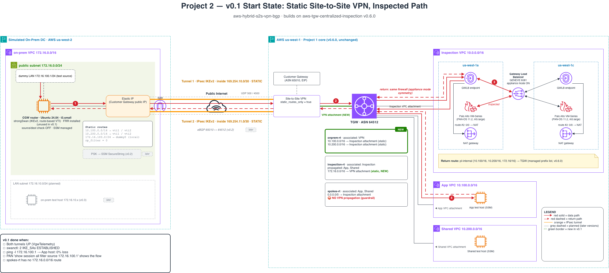

# aws-hybrid-s2s-vpn-bgp

Simulated on-prem data center (us-west-2) connected to the
[aws-tgw-centralized-inspection](https://github.com/adam-brown-cloudarchitect/aws-tgw-centralized-inspection)
Transit Gateway (us-west-1, v0.6.0) over AWS Site-to-Site VPN, with on-prem ↔ spoke
traffic inspected by the Palo Alto VM-Series layer.

## Roadmap
- v0.1 Static S2S VPN, inspected path
- v0.2 eBGP (65010 ↔ 64512), PSK in SSM SecureString
- v0.3 Firewall evidence + on-prem test host
- v0.4 Failure tests (tunnel loss, BGP withdrawal, ECMP vs active/standby)
- v0.5 Docs + release

## v0.1 target state

